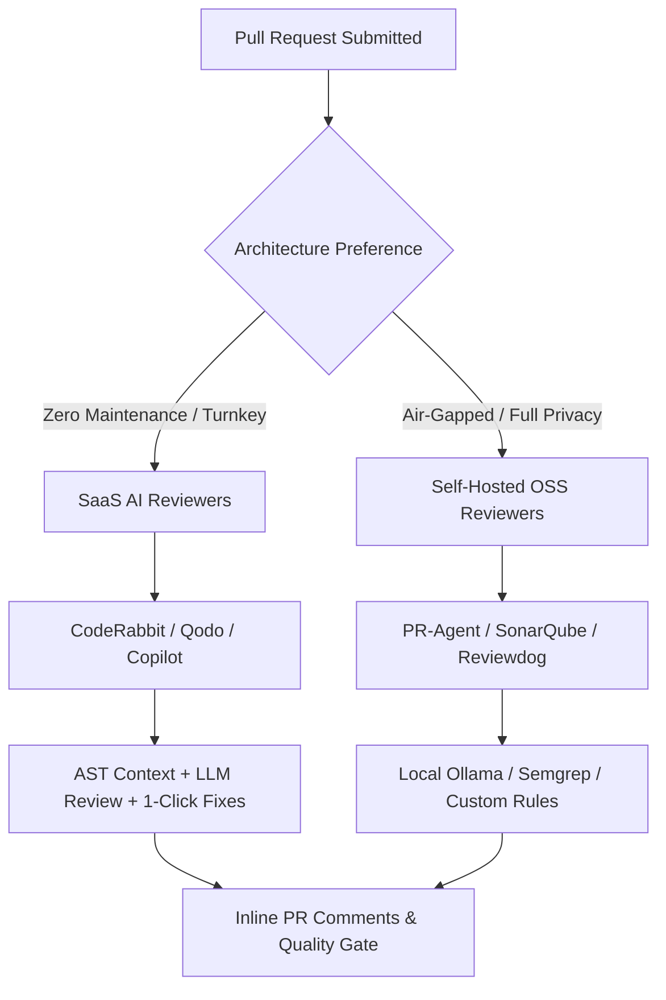

  

  
  
  
  
  
  
  

---

# 🚀 Awesome AI Code Review

> **A curated directory of top AI-powered code review platforms, automated pull request (PR) analyzers, intelligent static analysis systems, and developer feedback tools.**

As AI coding assistants accelerate software authoring, engineering velocity has hit a new constraint: **reviewing, auditing, and validating pull requests at scale**. This repository tracks leading commercial SaaS platforms and open-source GitHub projects designed to automatically spot logic regressions, security vulnerabilities, performance anti-patterns, and code smells before code hits production.

---

## 📑 Table of Contents

- [🌐 Sector Overview & Market Dynamics](#-sector-overview--market-dynamics)
- [💼 SaaS & Commercial Hosted Platforms](#-saas--commercial-hosted-platforms)
- [🔓 Open-Source GitHub Projects](#-open-source-github-projects)
- [⚖️ Architectural Comparison: SaaS vs. Self-Hosted](#️-architectural-comparison-saas-vs-self-hosted)
- [🤝 How to Contribute](#-how-to-contribute)
- [💖 Support & Sponsorship](#-support--sponsorship)
- [⭐ Star History](#-star-history)
- [📜 Disclaimer](#-disclaimer)

---

## 🌐 Sector Overview & Market Dynamics

* **Estimated Market Size**: The global market for AI coding assistants and AI-driven developer productivity tooling is valued at approximately **$7.4B – $7.9B in 2025** and projected to surpass **$9.5B – $10.1B in 2026**, registering a Compound Annual Growth Rate (CAGR) of over **26%**. As code creation becomes commoditized by LLMs, automated code review and quality gates represent the fastest-expanding operational category in modern DevOps.
* **Industry Fragmentation**: The sector is **moderately fragmented and rapidly evolving**. While hyperscale incumbents (Microsoft/GitHub, Snyk, GitLab) leverage massive distribution channels and IDE hooks, agile pure-play contenders (CodeRabbit, Qodo, SonarSource, Codacy) capture significant enterprise mindshare by providing specialized abstract syntax tree (AST) reasoning, multi-file context engines, proactive bug fixes, and rigorous false-positive suppression.

---

## 💼 SaaS & Commercial Hosted Platforms

The table below catalogs premier commercial and hosted AI code review systems. The list is sorted in descending order by estimated **Company Size (Revenue / Enterprise Valuation)**.

| 🏢 Platform / Product | 📊 Company Size (Valuation / Revenue) | 💳 Starting Pricing | 🎁 Free Tier Limits | 🔍 Key Capabilities & Focus |
| :--- | :--- | :--- | :--- | :--- |
| **[GitHub Copilot Code Review](https://github.com/features/copilot)** | ~$3.1T Market Cap *(Parent: Microsoft)* / $2B+ GitHub ARR | **$19 / user / month** *(Copilot Business)* or $10/mo *(Individual)* | **Free forever plan**: 2,000 code completions/month & 50 chat messages/month; or 30-day free trial on Individual | AI PR summaries, inline pull request review recommendations, and automated code review inside native GitHub pull requests. |
| **[DeepCode / Snyk Code](https://snyk.io/product/snyk-code/)** | **$7.4B Valuation** *(Series G)* | **$25 / product / month** *(Team tier)* or $52 / dev / month | **Free forever plan**: 300 Snyk Code SAST tests/month, 100 open source dependency tests/month, and 1 concurrent license | Hybrid symbolic AI and semantic deep learning for real-time security scanning and actionable remediation advice in PRs. |
| **[SonarQube Cloud / SonarCloud](https://www.sonarsource.com/products/sonarcloud/)** | **$4.7B Valuation** *($412M raised)* | **€10 / month (~$11/mo)** for private repos *(up to 100k LOC)* | **Free forever plan**: Unlimited lines of code & unlimited automated PR checks for all public/open-source repos; 14-day free trial for private repos | Deep static application security testing (SAST), AI-assisted clean code analysis, code coverage metrics, and PR quality gates. |
| **[Qodo (formerly CodiumAI)](https://www.qodo.ai/)** | **~$250M – $300M Valuation** *($50M raised)* | **$30 / workspace / month** *(includes pooled credits at ~$0.012/credit)* | **Free forever for public open-source repos**; 14-day free trial with full platform access and unlimited usage (no credit card required) | Agentic code review (`Qodo Merge`), test suite generation, contextual repository understanding, and interactive PR chat bots. |
| **[Codacy](https://www.codacy.com/)** | **~$80M – $100M Valuation** *($25M raised)* | **$15 / developer / month** *(billed annually)* or $18/mo *(monthly)* | **Free forever for open-source repos**; 14-day free trial for private repositories with full access to all Pro features and automated analysis | Unified code quality, automated PR comments across 40+ programming languages, test coverage tracking, and security checks. |
| **[CodeRabbit](https://www.coderabbit.ai/)** | **~$60M – $100M Valuation** *($16M Series A)* | **$24 / PR author / month** *(billed annually)* or $30/mo *(monthly)* | **Free forever for public open-source repos**; 14-day free trial for private repos with unlimited reviews and full Pro features (no credit card required) | Context-aware AI code reviewer generating line-by-line diff assessments, architectural diagrams, 1-click committable fixes, and conversational PR chat. |
| **[Swarmia](https://www.swarmia.com/)** | **~$50M Valuation** *(€11M Series A)* | **$15 / user / month** *(billed annually)* or $18/mo *(monthly)* | **Free forever plan**: Complete platform access for teams with up to 5 developers; 14-day free trial on the Standard tier | Engineering intelligence, PR review flow optimization, cycle-time telemetry, automated pull request hygiene checks, and AI delivery insights. |
| **[Sourcery](https://sourcery.ai/)** | **~$20M Valuation** *($5.5M raised)* | **$20 / author / month** *(billed annually)* or $24/mo *(monthly)* | **Free forever for open-source public repos** and local IDE refactoring; 14-day free trial for Team PR reviews | Instant automated refactoring suggestions, complexity reduction, duplicate code elimination, and AI review comments on GitHub. |
| **[Bito AI](https://bito.ai/)** | **~$15M – $20M Valuation** *($3.2M Seed)* | **$15 / user / month** *(or $12/mo billed annually for 10X Developer)* | **Free forever plan**: 15 advanced AI (GPT-4) requests/day & unlimited standard AI requests; 14-day free trial of 10X Developer plan | Automated PR reviews, high-level pull request summaries, test case generation, and security & performance auditing. |
| **[ReviewNB](https://www.reviewnb.com/)** | **~$3M – $5M Valuation** *(Bootstrapped, ~$500k ARR)* | **$7 / user / month** *(billed annually)* or $10/mo *(monthly)* | **Free forever for all public/open-source GitHub repos**; 14-day free trial with full feature access for private repositories | Visual diffs and interactive threaded code reviews tailored specifically for Jupyter Notebooks (`.ipynb`) on GitHub. |

---

## 🔓 Open-Source GitHub Projects

Explore battle-tested open-source repositories for self-hosted AI code review, deterministic static analysis, and PR triage automation. The list is sorted in descending order by **GitHub Stars_Count**.

| 📦 Repository | ⭐ Popularity | 💻 Primary Stack | 🛠️ Overview & Role in Review Pipeline |
| :--- | :---: | :---: | :--- |
| **[semgrep/semgrep](https://github.com/semgrep/semgrep)** |  | OCaml / Python | Fast, lightweight static analysis engine for enforcing custom semantic code rules and automated vulnerability detection in PR checks. |
| **[facebook/infer](https://github.com/facebook/infer)** |  | OCaml / C++ | Meta's static analyzer for Java, C, C++, and Objective-C that catches null pointer exceptions, resource leaks, and concurrency bugs prior to merge. |
| **[The-PR-Agent/pr-agent](https://github.com/The-PR-Agent/pr-agent)** |  | Python | The de-facto open-source AI PR reviewer by Qodo. Auto-generates PR descriptions, interactive reviews, security audits, and code improvements. |
| **[SonarSource/sonarqube](https://github.com/SonarSource/sonarqube)** |  | Java / TypeScript | The gold standard open-source platform for continuous code quality inspection, vulnerability auditing, test coverage tracking, and quality gating. |
| **[github/codeql](https://github.com/github/codeql)** |  | QL / C++ | GitHub's industry-standard semantic code analysis engine that treats code as data to query vulnerabilities and security defects across PRs. |
| **[reviewdog/reviewdog](https://github.com/reviewdog/reviewdog)** |  | Go | Automated code review agent that posts linter and static analyzer diagnostics directly as inline review comments on GitHub, GitLab, and Bitbucket. |
| **[sweepai/sweep](https://github.com/sweepai/sweep)** |  | Python / TypeScript | Autonomous AI junior developer that turns bug reports into PRs, reads diffs, executes test suites in sandboxes, and addresses review feedback. |
| **[danger/danger](https://github.com/danger/danger)** |  | Ruby / JS / Swift | Programmatic pull request governance tool that codifies team cultural rules, changelog enforcement, and CI metadata checks directly into PR comments. |
| **[anc95/ChatGPT-CodeReview](https://github.com/anc95/ChatGPT-CodeReview)** |  | TypeScript | Lightweight GitHub Action / Probot app that leverages OpenAI's ChatGPT models to automatically review diffs and suggest patches upon PR updates. |
| **[appleboy/CodeGPT](https://github.com/appleboy/CodeGPT)** |  | Go | CLI tool powered by OpenAI GPT-4o that produces concise git commit messages, summarizes code diffs, and generates pre-merge review briefs. |
| **[villesau/ai-codereviewer](https://github.com/villesau/ai-codereviewer)** |  | TypeScript | GitHub Action for automated pull request code reviews using OpenAI GPT-4 with configurable prompt templates and markdown comment formatting. |
| **[sturdy-dev/codereview.gpt](https://github.com/sturdy-dev/codereview.gpt)** |  | Go | Self-hostable CLI and CI workflow engine that analyzes GitHub/GitLab pull requests and writes inline review comments via LLMs. |
| **[Nikita-Filonov/ai-review](https://github.com/Nikita-Filonov/ai-review)** |  | Python | Flexible multi-model AI code reviewer supporting OpenAI, Claude, Gemini, and local Ollama instances within GitLab and GitHub CI/CD pipelines. |

---

## ⚖️ Architectural Comparison: SaaS vs. Self-Hosted

* **When to select SaaS**: Teams seeking instantaneous setup, multi-file code graph awareness, zero server maintenance, and turnkey integrations with GitHub, GitLab, and Bitbucket.
* **When to select Open-Source**: Teams with stringent data-residency, SOC2, or air-gapped requirements who require local model execution (e.g. via Ollama / vLLM) and bespoke static analysis rules.

---

## 🤝 How to Contribute

Contributions, bug reports, and project submissions are warmly welcomed! 🌟

1. **Fork the repository** on GitHub.
2. **Create a feature branch**: `git checkout -b add/my-awesome-tool`.
3. **Add your product or project**:
   * For **SaaS tools**: Provide company size, specific starting tier pricing, specific free tier limits, and capabilities.
   * For **Open-source projects**: Provide repository link, stargazers badge (`style=social&color=white`), tech stack, and description.
4. **Submit a Pull Request** with a brief summary of why the tool adds value to the AI code review ecosystem.

Please refer to the curated lists index at [Awesome-Awesome-Awesome](https://github.com/ishandutta2007/Awesome-Awesome-Awesome) for more curated software collections.

---

## 💖 Support & Sponsorship

If this curated collection helped you or your engineering team discover better code review tooling, please consider supporting the project:

* ⭐ **Star this repository** to help others discover it on GitHub.
* 🍴 **Fork and share** it with your engineering peers and developer communities.
* ☕ **Sponsor or buy a coffee**: Support ongoing maintenance and open-source curation via the [GitHub Sponsors Dashboard](https://github.com/sponsors/ishandutta2007).

Your backing fuels continuous updates, in-depth benchmark comparisons, and new ecosystem research! 🙏

---

## ⭐ Star History

---

## 📜 Disclaimer

* This repository is an independent, community-driven directory and is not officially affiliated with or endorsed by any vendor listed.
* AI-assisted code reviews provide probabilistic guidance and automated suggestions. They should always be paired with human engineering review, robust CI test suites, and comprehensive security auditing.

---

  <b>Built with ❤️ for developers, engineering leaders, and open-source advocates worldwide.</b>

